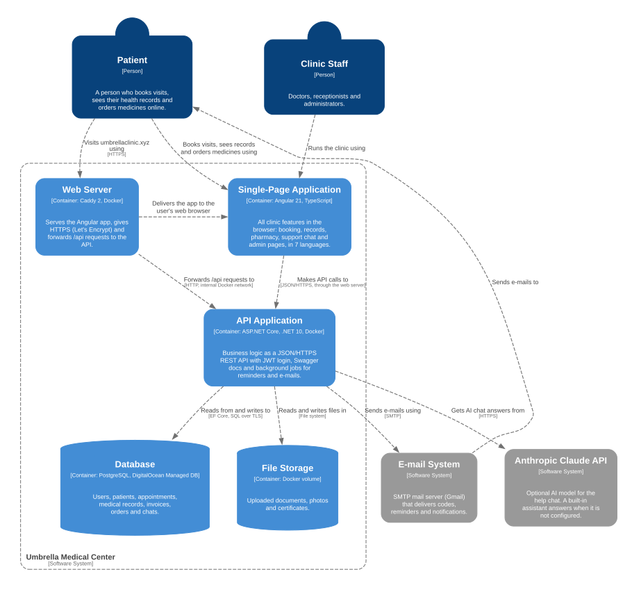

# Umbrella Medical Center

A complete clinic management system: patients find a doctor, book and pay for visits online, see their medical records, prescriptions and bills, order medicines from the clinic pharmacy with home delivery, and chat with the clinic. Doctors, receptionists and administrators run the clinic from the same application.

**Live:** https://umbrellaclinic.xyz · **API documentation (Swagger):** https://umbrellaclinic.xyz/swagger · **Health:** [/health/live](https://umbrellaclinic.xyz/health/live), [/health/ready](https://umbrellaclinic.xyz/health/ready)

The site works in **7 languages** (English, Georgian, German, French, Italian, Spanish, Russian), in light and dark mode, on phones, tablets and desktops.

> The name and logo are inspired by Resident Evil's Umbrella Corporation. The system itself is an ordinary, professional clinic application.

---

## Contents
- [Features](#features)
- [Roles](#roles)
- [Technology](#technology)
- [Architecture](#architecture)
- [Run it locally](#run-it-locally)
- [Demo accounts and test card](#demo-accounts-and-test-card)
- [Configuration](#configuration)
- [Tests and CI](#tests-and-ci)
- [Deployment](#deployment)
- [Security](#security)
- [Translations](#translations)
- [Database](#database)

---

## Features

### For patients
- **Find a doctor:** 88 doctors in 20 specializations, with profiles (bio, education, experience, optional photo), working hours and patient reviews (half-star averages). Search by name or specialty.
- **Online booking:** free time slots are calculated from each doctor's working hours minus existing bookings and approved time off. Booking is conflict-safe; visits can be moved or cancelled (not within 2 hours of the start).
- **Pay online:** the patient pays their share after insurance by card when booking. Cancelling refunds the card automatically.
- **My health:** profile, allergies, medical records with diagnoses (ICD-10), vital signs and a dental chart, prescriptions with pharmacy codes, uploaded documents, and a **visit summary PDF** in the patient's language.
- **Pharmacy:** 95 products with real photos in 6 categories. Filters by category (with live counts), price range, prescription and stock, plus search, sorting and a **details page** for every product.
  - **Prescription-only medicines** need a valid prescription code from a doctor, or an uploaded prescription that the pharmacist checks.
  - **Pickup at the clinic** (free, 24/7) or **home delivery in Tbilisi** (₾5, free from ₾50, within 24 hours), with a delivery tracker: paid → preparing → on its way → delivered.
- **Support chat** with the clinic's staff, **in real time (SignalR)**: messages arrive instantly, with a "typing…" indicator, "seen" receipts and online / away / offline status for both sides.
- **Help chat ("Ask us")** that answers questions about doctors, services, prices and booking in the visitor's language (see [Help chat](#help-chat)).
- **Notifications** pushed to the site the moment they are created (SignalR) and by e-mail (optional), in the patient's own language; appointment reminders 24 hours before a visit.
- **Profile settings:** personal details, preferred language and theme, e-mail notification preferences.

### For clinic staff
- **Doctors:** own schedule and working hours, appointment desk, patient charts, medical records and prescriptions for their patients, document uploads, time-off requests, answering prescription requests.
- **Receptionists:** register patients, book and change appointments, manage insurance, invoices and payments, check prescriptions on pharmacy orders, hand over orders or send them out for delivery.
- **Administrators:** everything above, plus staff and user accounts, departments, rooms, services and prices, pharmacy products and photos, insurers, review moderation, time-off approval, contact form messages (reply by e-mail or **in the support chat**), and **reports** (visits, revenue, doctors, popular services) with date-range presets and CSV export.
- **Audit log** of access to and changes of sensitive data.

## Roles
| Role | What they can do |
|---|---|
| Guest | Browse doctors, services, prices and the pharmacy; use the help chat; send a contact message |
| Patient | Book, pay, move or cancel their own visits; see their own records, prescriptions, documents, invoices and notifications; order from the pharmacy; review a doctor after a completed visit; chat with support |
| Doctor | Manage their own working hours and appointments; write records and prescriptions for patients they treat; upload files; request time off |
| Receptionist | Register patients, manage appointments, insurance, invoices and payments, and pharmacy orders. **No access to medical records** |
| Admin | Everything above plus clinic setup, staff, reports, moderation and the support inbox |

## Technology
| Part | Technology |
|---|---|
| Back-end | ASP.NET Core Web API on **.NET 10**, C# |
| Database | **PostgreSQL** with Entity Framework Core 10 (Npgsql), code-first migrations |
| Front-end | **Angular 21** (standalone components, signals), TypeScript, SCSS |
| Authentication | JWT bearer tokens, BCrypt password hashing, role-based authorization, e-mail verification codes |
| Real-time | **ASP.NET Core SignalR** over WebSockets (@microsoft/signalr in the browser) |
| PDF | QuestPDF (visit summaries, with Georgian fonts) |
| E-mail | MailKit over SMTP |
| AI (optional) | Anthropic Claude API for the help chat |
| API documentation | Swagger / OpenAPI (Swashbuckle), public |
| Tests | xUnit |
| DevOps | Docker, Docker Compose, Caddy (HTTPS from Let's Encrypt), GitHub Actions, DigitalOcean (Droplet + Managed PostgreSQL) |

## Architecture
The architecture is documented with the **C4 model** in [`docs/architecture`](docs/architecture). It covers system context, containers, the components of the API, and a class diagram of the chat assistant. The full set is in [`Umbrella-C4-model.pdf`](docs/architecture/Umbrella-C4-model.pdf).



- The **Angular single-page application** runs in the browser.
- **Caddy** serves the app over HTTPS and forwards `/api`, `/swagger` and `/health` to the API.
- The **ASP.NET Core API** holds all the business logic and runs background jobs for reminders and notification e-mails.
- A **SignalR hub** (/api/hubs/realtime) pushes support chat messages, typing indicators, read receipts, presence changes and new notifications to every open tab over a WebSocket. See [Real-time updates](#real-time-updates).
- Data lives in **PostgreSQL**; uploaded files live in a Docker volume.

```
UmbrellaMedical.slnx
  UmbrellaMedical.Domain          entities and enums, no dependencies
  UmbrellaMedical.Infrastructure  DbContext, migrations, seed and demo data
  UmbrellaMedical.Api             controllers, DTOs, services, background jobs, Program.cs
  UmbrellaMedical.Tests           unit tests
frontend/                         Angular application (+ Caddyfile and Dockerfile for the web container)
deploy/                           docker-compose.yml, .env.example, DEPLOY.md
database/schema.sql               full SQL schema generated from the migrations
docs/architecture/                C4 model diagrams (PDF, SVG and Graphviz sources)
.github/workflows/ci.yml          CI: build and test the API, build the website
```
The dependency direction is Api → Infrastructure → Domain.

## Run it locally
**You need:** .NET 10 SDK, Node.js 22, PostgreSQL 16+.

1. **Secrets.** In Visual Studio right-click `UmbrellaMedical.Api` → *Manage User Secrets* (or use `dotnet user-secrets`) and add:
   ```json
   {
     "ConnectionStrings": { "DefaultConnection": "Host=localhost;Port=5432;Database=umbrella;Username=postgres;Password=..." },
     "Jwt": { "Key": "a random string of at least 32 characters" },
     "Seed": { "AdminPassword": "a strong password" }
   }
   ```
2. **API.** Run `dotnet run --project UmbrellaMedical.Api` (or press F5).
   - It applies the migrations and seeds the starter data and, in Development, the demo data on start.
   - Swagger is at https://localhost:7128/swagger.
3. **Website.** Run these commands:
   ```bash
   cd frontend
   npm ci
   npm start            # http://localhost:4200, /api (including the SignalR WebSocket) is proxied to the API
   ```

In Development without SMTP settings, e-mails are written to the API console instead of being sent.

### Help chat
The "Ask us" chat answers questions about doctors, services, prices, booking, payments and using the site, in the visitor's language. It never gives diagnoses or medicine advice, points emergencies to 112, and only uses public clinic facts (never patient data).
- **Default:** the built-in assistant (`RuleBasedChatAssistant`) recognises questions by keywords in all 7 languages, maps everyday symptoms to the right specialty ("toothache" → dentist, "heartburn" → gastroenterologist), and answers from the live database. It's free, instant and works offline.
- **With a Claude API key (optional):** free-form answers by Claude (`claude-opus-5-5`), falling back to the built-in assistant if a request fails. Set `Anthropic:ApiKey`.

### Real-time updates
UmbrellaMedical.Api/Hubs/RealtimeHub.cs is a **SignalR hub** at /api/hubs/realtime. It accepts logged-in users only (the JWT is passed as ccess_token for this path, because browsers can't send headers on WebSockets).
- **Groups:** each connection joins its user's group (user-{id}); admins also join the support team's group.
- **Pushed events:**
  - support:message, support:read, support:changed, support:typing: the support chat.
  - presence: someone went online, away or offline.
  - 
otification: a new notification was created.
- **Notifications from anywhere:** an EF Core save interceptor (NotificationPushInterceptor) announces every new notification after it is saved, wherever in the code it was created (bookings, orders, prescriptions, the reminder job).
- **Presence follows the connection:** a person is online while a tab is connected, away after 2 idle minutes, and offline as soon as their last tab closes.
- **Fallback:** if the WebSocket can't connect (e.g. a blocking proxy), the website falls back to polling automatically, and a badge on the Support chat page shows **● Live** or **Reconnecting…**.
- **Scaling:** one API instance needs nothing more. Several instances would need a SignalR backplane (Redis or Azure SignalR Service).

## Demo accounts and test card
Demo data is created in Development, and on a server when `Seed:DemoPatients=true` and `Seed:DemoStaffPassword` is set. **Logging in needs the e-mail, first name, last name and password.**

| Role | E-mail | Name | Password |
|---|---|---|---|
| Admin | `admin@umbrella.local` | any | value of `Seed:AdminPassword` |
| Doctor (88) | `firstname.lastname@umbrella.local`, e.g. `nino.beridze@umbrella.local` | Nino Beridze | `Umbrella123` (`Seed:DemoStaffPassword`) |
| Receptionist (3) | e.g. `ketevan.natsvlishvili@umbrella.local` | Ketevan Natsvlishvili | `Umbrella123` |
| Patient (40) | `firstname.lastname@example.com`, e.g. `mariam.kapanadze@example.com` | Mariam Kapanadze | `Patient123` |

Demo patients have past visits with medical records, prescriptions and reviews. `@example.com` addresses never receive mail.

**Payments use `TestPaymentGateway`; no real money moves.**
- **Test cards:**
  - `4242 4242 4242 4242` succeeds.
  - `4000 0000 0000 0002` is declined.
  - `4000 0000 0000 9995` has insufficient funds.
- **Other card fields:** any future expiry date (e.g. `12/30`), any CVC.
- **Real payments:** implement `IPaymentGateway` for a provider (Stripe, Bank of Georgia, TBC…) and register it in `Program.cs`.

## Configuration
| Setting | Purpose |
|---|---|
| `ConnectionStrings:DefaultConnection` | PostgreSQL connection |
| `Jwt:Key`, `Jwt:Issuer`, `Jwt:Audience`, `Jwt:ExpiryMinutes` | Token signing (the key is a secret, at least 32 characters) |
| `Seed:AdminPassword` | Password of the first admin account |
| `Seed:DemoStaffPassword` | Shared password of the demo doctors and receptionists (`Umbrella123` in Development); unset = no demo staff on a server |
| `Seed:DemoPatients` | `true` to create the demo patients, visits and reviews on a server |
| `Email:Host`, `Email:Port`, `Email:Username`, `Email:Password`, `Email:FromAddress`, `Email:FromName` | SMTP (for Gmail use an app password) |
| `Clinic:ContactEmail` | Inbox that receives contact form messages |
| `Clinic:TimeZone` | Clinic time zone, default `Asia/Tbilisi` |
| `Reminders:Enabled`, `Reminders:HoursBefore`, `Reminders:CheckIntervalMinutes` | Appointment reminders |
| `Anthropic:ApiKey` | Optional Claude API key for the help chat |
| `RateLimiting:GlobalPerMinute`, `RateLimiting:AuthPerMinute`, `RateLimiting:ChatPerMinute` | Rate limits per IP (200 / 10 / 12) |
| `Cors:AllowedOrigins` | Browser origins allowed to call the API directly (not needed behind Caddy: same origin) |
| `Storage:RootPath` | Folder for uploaded files, default `App_Data/uploads` |

In production, set these as environment variables with a double underscore, e.g. `Jwt__Key` (see [`deploy/.env.example`](deploy/.env.example)).

## Tests and CI
```bash
dotnet test
```
78 unit tests cover:
- free-slot calculation
- billing and insurance maths
- delivery fees and cities
- the clinic clock and time zones
- registration age rules
- verification codes and tokens
- the reminder job
- presence (online, away, offline across tabs)
- localized account e-mails

**GitHub Actions** ([`.github/workflows/ci.yml`](.github/workflows/ci.yml)) runs on every push and pull request to `master`/`main`, with two parallel jobs:
1. **API (.NET):** restore, Release build and the unit tests.
2. **Website (Angular):** `npm ci` from the lock file and a production build.

## Deployment
Production runs on **DigitalOcean**:

| Part | What it is |
|---|---|
| Droplet (Ubuntu + Docker) | `web` container: **Caddy** serves the Angular build over HTTPS (Let's Encrypt) and forwards `/api`, `/swagger`, `/health` to the API. `api` container: the ASP.NET Core API (internal network only) |
| Managed PostgreSQL | The database, backed up daily by DigitalOcean |
| Docker volume `uploads` | Uploaded photos and documents |

The API applies the migrations on start. To update the server:

```bash
cd /opt/umbrella/deploy && docker compose up -d --build
```

Step-by-step setup is in [`deploy/DEPLOY.md`](deploy/DEPLOY.md).

**Monitoring:**
- `GET /health/live` answers `Healthy` when the API runs.
- `GET /health/ready` answers `Healthy` when it can also reach the database.

## Security
- Passwords hashed with BCrypt. Verification codes are stored only as keyed hashes; they expire after 10 minutes, work once and lock after 5 wrong tries.
- Short-lived JWTs; deactivated accounts are rejected on the next request.
- **Patients must confirm their e-mail** before they can book a visit or buy something. Registration sends a 6-digit code at once, and the API enforces it with `[RequireConfirmedEmail]` (403 `email_not_confirmed`); the website shows a confirm-code box in place of the pay button.
- **Ownership checks** on every endpoint that takes an id. Receptionists can't read medical records. Prescription codes can't be probed (the same answer for "not found" and "someone else's").
- **Payments and prices are computed on the server**: order totals, delivery fees and insurance shares are never taken from the browser.
- Rate limiting, security headers, HTTPS only.
- Uploaded files are checked by extension, size and content signature and are never served as static files.
- Card details are never stored; only the brand and last 4 digits are kept on the receipt.
- Secrets come from User Secrets or environment variables, never from the repository.

## Translations
- **Website texts:** `frontend/src/app/core/i18n/{ka,de,fr,it,es,ru}.ts`. The English source text is the key; templates use the `t` pipe, and dates use the `ldate` pipe.
- **E-mails, notifications, chat answers and PDFs:** `UmbrellaMedical.Api/SeedData/i18n/{lang}.json`, through `IClinicText`. Each person gets messages in their saved preferred language.
- **Not translated:** medical content written by doctors (complaints, diagnosis notes, treatment) stays as written.

## Database
PostgreSQL, created and updated by EF Core migrations on start. Starter data is seeded too: roles, specializations, departments, services, diagnoses, medications, allergies, insurers and pharmacy products with photos. Regenerate `database/schema.sql` with:
```bash
dotnet ef migrations script --idempotent --project UmbrellaMedical.Infrastructure --startup-project UmbrellaMedical.Api --output database/schema.sql
```

---

Product photos are openly licensed images (CC0, public domain, CC BY, CC BY-SA), credited on the site's [Photo credits](https://umbrellaclinic.xyz/photo-credits.html) page.
